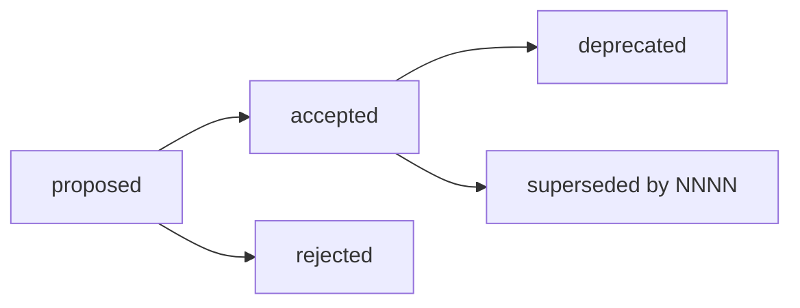

# Architecture Decision Records

An Architecture Decision Record (ADR) is a short document that explains one important technical decision: the context, the options we considered, what we chose and what it means for the project. ADRs record **why** the system is built the way it is. For **how** it fits together, see [`docs/architecture/`](../architecture/README.md).

## When to write one

Write an ADR when a decision:

- is hard to reverse (a framework, a database, a provider, a data format);
- affects more than one app or package; or
- is something people will ask "why?" about later.

Bug fixes, refactors inside one module and library upgrades don't need an ADR.

## Format

- One file per decision, named `NNNN-kebab-case-title.md` (for example `0005-orm-and-migrations.md`).
- Numbers are sequential and never reused, even if the ADR is rejected. Take the next free number in the index below.
- Start from [`template.md`](template.md). Keep it short: one or two pages is enough.
- Write in English.

## Statuses

| Status               | Meaning                                                   |
| -------------------- | --------------------------------------------------------- |
| `proposed`           | Open for discussion in a pull request.                    |
| `accepted`           | Approved and in effect.                                   |
| `rejected`           | Discussed and not adopted. The file stays for the record. |
| `deprecated`         | No longer applies, and nothing replaces it.               |
| `superseded by NNNN` | Replaced by a newer ADR, linked in the status line.       |

Accepted ADRs are not edited, except to change their status. To change a decision, write a new ADR and mark the old one as `superseded by NNNN`.

## Process

1. Copy `template.md` to `NNNN-kebab-case-title.md` with status `proposed`, and add it to the index.
2. Open a pull request with only the ADR, or make it the first commit of the pull request that implements it.
3. At least **two people** approve the pull request. Discussion happens in the review.
4. Before merging, change the status to `accepted` (or `rejected`) and update the index.

## Index

| ADR                                               | Title                                                       | Status   | Date       |
| ------------------------------------------------- | ----------------------------------------------------------- | -------- | ---------- |
| [0001](0001-monorepo-pnpm-turborepo.md)           | Monorepo with pnpm workspaces and Turborepo                 | accepted | 2026-11-08 |
| [0002](0002-application-stack.md)                 | Application stack: NestJS, React + Vite PWA and Next.js     | accepted | 2026-11-08 |
| [0003](0003-vonage-as-communications-provider.md) | Vonage as the communications provider                       | accepted | 2026-11-08 |
| [0004](0004-shared-types-as-api-contract.md)      | `@csl/shared-types` is the API contract                     | accepted | 2026-11-08 |
| [0005](0005-orm-and-migrations.md)                | Drizzle ORM and SQL migrations for PostgreSQL               | proposed | 2026-11-08 |
| [0006](0006-internationalisation.md)              | Internationalisation with next-intl and use-intl            | proposed | 2026-11-08 |
| [0007](0007-zod-schemas-as-runtime-contract.md)   | Zod schemas in `@csl/contracts` as the runtime API contract | proposed | 2026-11-09 |
| [0008](0008-authentication-and-sessions.md)       | Authentication and sessions                                 | proposed | 2026-11-11 |
| [0009](0009-hosting-on-railway.md)                | Hosting on Railway                                          | proposed | 2026-11-12 |

### Pending decisions

These decisions still need an ADR. Each one is written as part of its issue and takes the next free number when it is opened.

| Decision                                         | Issue      | Status |
| ------------------------------------------------ | ---------- | ------ |
| Evidence storage                                 | [#32][i32] | to do  |
| Real-time updates for the CRM (SSE vs WebSocket) | [#40][i40] | to do  |

[i32]: https://github.com/femCodersClub-vonage-program/customer-support-logistics/issues/32
[i40]: https://github.com/femCodersClub-vonage-program/customer-support-logistics/issues/40
