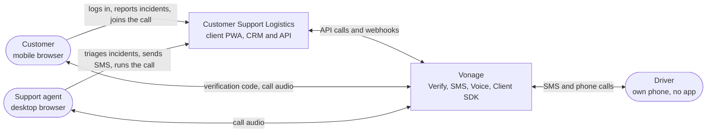
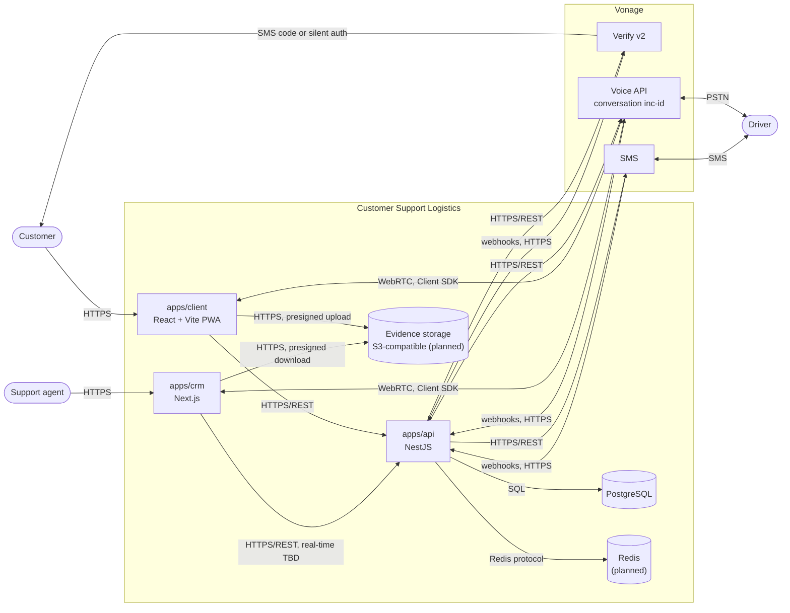
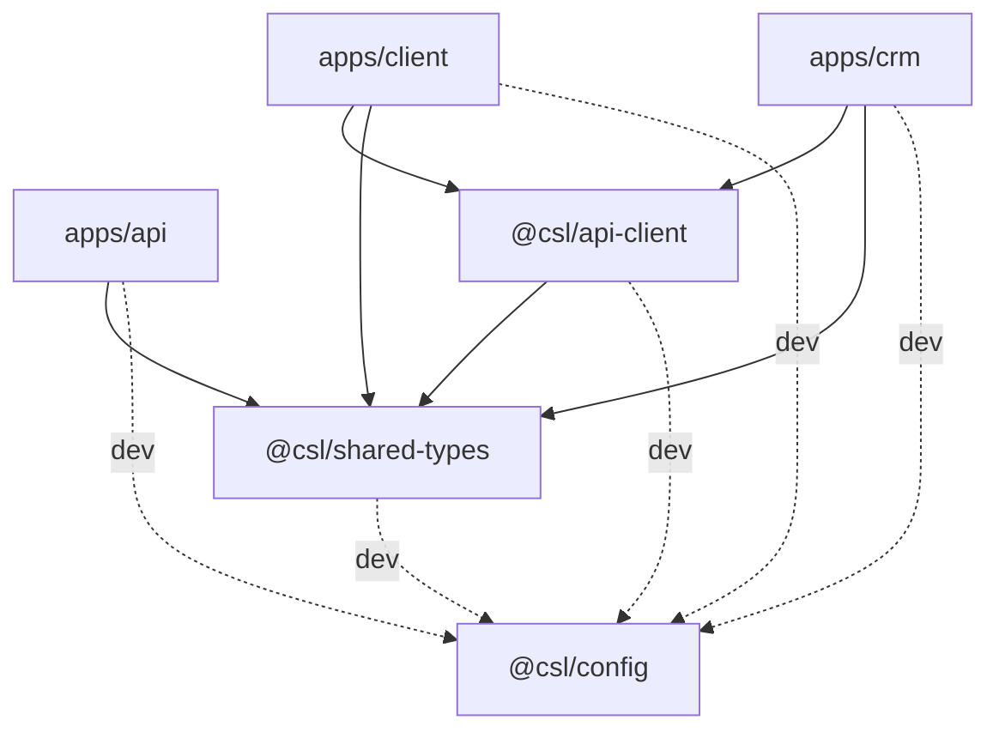

# Architecture

This page explains how the system fits together: who uses it, which parts it has, how they talk to each other and how we handle the concerns they share. The reasons behind each choice are in the [Architecture Decision Records](../adr/README.md). How each Vonage API is used is in [`vonage.md`](vonage.md).

Parts marked _planned_ don't exist in the code yet; the linked issue is where they will be built.

## System context

The platform resolves last-mile delivery incidents by putting the customer, the support agent and the driver on the same call. The driver doesn't install anything: they are reached by SMS and ordinary phone calls.

| Role          | Interface                  | Main actions                                                                         |
| ------------- | -------------------------- | ------------------------------------------------------------------------------------ |
| Customer      | `apps/client` (mobile PWA) | Log in with their phone, see orders, report an incident with evidence, join the call |
| Support agent | `apps/crm` (desktop web)   | Triage incidents, see evidence, send SMS, start and run the call, close the incident |
| Driver        | Their phone (SMS and PSTN) | Receive SMS, answer the call, press 1 to join, reply by SMS                          |

## Containers

| Container        | Responsibility                                                                                                        | Status                                                                             |
| ---------------- | --------------------------------------------------------------------------------------------------------------------- | ---------------------------------------------------------------------------------- |
| `apps/client`    | Customer PWA: login, orders, incident report with evidence, mediation call (`/call/:id`)                              | Shell and routes exist; features planned                                           |
| `apps/crm`       | Agent CRM: inbox, incident detail, mediation console (`/incidents/:id/mediation`)                                     | Shell and routes exist; features planned                                           |
| `apps/api`       | REST API, incident state machine, Vonage calls and webhooks, Client SDK tokens. The only part with Vonage credentials | `/health` exists; modules planned ([#27]–[#30])                                    |
| PostgreSQL       | Orders, routes, incidents, evidence metadata, communications and incident events                                      | Schema and migrations with Drizzle ([ADR 0005](../adr/0005-orm-and-migrations.md)) |
| Redis            | Queues for call retries and scheduled SMS, idempotent webhook processing                                              | In Docker Compose; not used yet                                                    |
| Evidence storage | Photos and videos from customers, in a private bucket                                                                 | Planned ([#32])                                                                    |
| Vonage           | Verification, SMS, voice calls and browser calls                                                                      | Planned ([#29], [#30])                                                             |

The API never carries audio. It creates the conversation, issues Client SDK tokens and reacts to webhooks; the audio goes directly between the browsers, the phone network and Vonage.

## Monorepo

The repository is a pnpm + Turborepo monorepo ([ADR 0001](../adr/0001-monorepo-pnpm-turborepo.md)). Structure, scripts and shared config are described in the [root README](../../README.md).

- **`@csl/shared-types`** is the API contract: plain TypeScript types shared by the API and the frontends. Database models stay inside `apps/api` ([ADR 0004](../adr/0004-shared-types-as-api-contract.md)).
- **`@csl/api-client`** wraps `fetch` for the frontends, with typed responses and the auth token.
- **`@csl/config`** holds the TypeScript, ESLint and Prettier presets. It is only a dev dependency.

Dashed arrows are dev dependencies. `apps/api` needs `@csl/shared-types` at runtime, because its database schema builds the Postgres enums from the shared `as const` arrays.

## Cross-cutting concerns

**Configuration and env validation.** Each app reads its configuration from environment variables, with an `.env.example` in each app. The API validates them at startup with a Zod schema (`apps/api/src/config/env.schema.ts`) through `ConfigModule`, and refuses to start if a variable is invalid. The frontends only need `API_URL`.

**Authentication.** _Planned_ in [#31], with its own ADR. Customers log in with their phone number through Verify v2 (silent auth, then SMS code). Agents use a CRM login. The API protects routes with NestJS guards by role (`customer`, `agent`); drivers never log in. `@csl/api-client` already accepts a `getToken` function.

**Webhook security.** Implemented in [#30] (`apps/api/src/webhooks`). Webhooks live under `/webhooks/*`, are public and don't use the auth guards. Instead, they check Vonage's signature with `VONAGE_SIGNATURE_SECRET`, reject anything unsigned with `401`, and are idempotent: each event is stored once using Vonage's own id, because Vonage retries on failure. They are also rate-limited per client IP (`WEBHOOK_RATE_LIMIT_PER_MINUTE`, in memory). Behind a reverse proxy the socket address isn't the client's. On Railway the client IP comes from the `X-Real-IP` header (`CLIENT_IP_HEADER`, see [Deployment](deployment.md#client-ip)). The storage moves to Redis if the API runs more than one instance.

**Persistence.** PostgreSQL 17, already in `docker-compose.yml` and in CI, with `DATABASE_URL` required by the API. The API uses Drizzle ORM with SQL migrations generated by `drizzle-kit` ([ADR 0005](../adr/0005-orm-and-migrations.md)). Migrations run as a separate step, never on app boot (see [`apps/api/README.md`](../../apps/api/README.md)). `GET /health/ready` reports whether the database is reachable. Every incident status change is validated in the API and recorded as an `IncidentEvent` ([#27]).

**File storage.** _Planned_ in [#32]. Evidence goes to a private S3-compatible bucket (MinIO in local). The browser uploads and downloads files with short-lived presigned URLs, so files never go through the API; the API only stores the metadata (`Evidence`).

**Real-time updates.** _Planned_ in [#40]. The CRM inbox and incident detail update on their own when an incident changes. Server-Sent Events versus WebSocket is still open and will be decided in an ADR.

**Background jobs.** _Planned_. Redis (`REDIS_URL`, optional for now) is meant for queues: driver call retries, scheduled SMS and slow webhook work. The technical proposal suggests BullMQ.

**Internationalisation.** Decided in [ADR 0006](../adr/0006-internationalisation.md) ([#26]). Screen copy comes from translation files in each app (`use-intl` in the client, `next-intl` in the CRM), and SMS, voice and Verify messages use each recipient's `locale`. How to add keys and languages, and the SMS length of each template, are in [i18n](../i18n.md).

**Privacy.** Real phone numbers stay in the API (`Customer`, `Driver`) and are never shown to the other party: calls and SMS go through the Vonage virtual number. Logs must mask phone numbers and never print secrets.

**Logging.** TBD. The API currently uses NestJS's default logger.

**Deployment.** Decided in [ADR 0009](../adr/0009-hosting-on-railway.md) ([#57]). The API, the client, the CRM and PostgreSQL run on Railway, deployed from `develop`, each app from its own Dockerfile. The client is served by Caddy and the CRM by `next start`; both forward `/api/*` to the API over the private network. Migrations run as Railway's pre-deploy step. Every service setting is listed in [Deployment](deployment.md). Vonage must reach the webhooks over public HTTPS (`PUBLIC_URL`): in development we use a tunnel such as ngrok, and the deployment isn't connected to Vonage yet ([#57]). CI runs lint, tests and build for each app on pull requests to `develop` and `main`.

[#26]: https://github.com/femCodersClub-vonage-program/customer-support-logistics/issues/26
[#27]: https://github.com/femCodersClub-vonage-program/customer-support-logistics/issues/27
[#29]: https://github.com/femCodersClub-vonage-program/customer-support-logistics/issues/29
[#30]: https://github.com/femCodersClub-vonage-program/customer-support-logistics/issues/30
[#31]: https://github.com/femCodersClub-vonage-program/customer-support-logistics/issues/31
[#32]: https://github.com/femCodersClub-vonage-program/customer-support-logistics/issues/32
[#40]: https://github.com/femCodersClub-vonage-program/customer-support-logistics/issues/40
[#57]: https://github.com/femCodersClub-vonage-program/customer-support-logistics/issues/57
