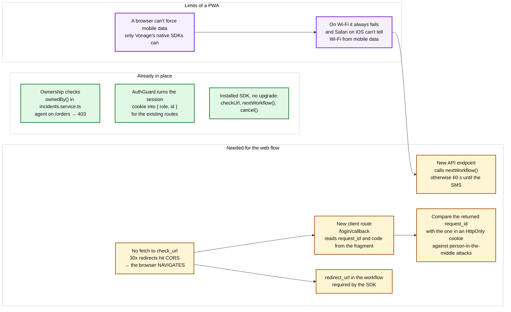
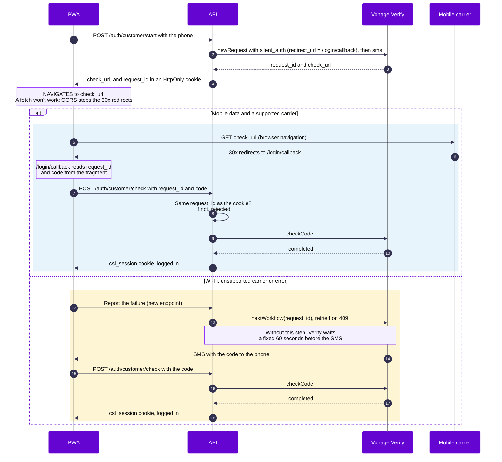

# Silent authentication from the PWA

> **Status:** planned. Customer login with Verify v2 is the next part of [#31] (API) and [#33] (client). This page records what the web flow needs, so both sides build the same thing.

[ADR 0008](../adr/0008-authentication-and-sessions.md) decides how customers log in: Verify v2 with `silent_auth` first and `sms` as fallback. This page goes one level deeper. A PWA runs in a browser, not in a native app, and that changes how silent authentication has to be wired.

## What is already in place

- **Ownership checks.** `ownedBy()` in `apps/api/src/incidents/incidents.service.ts` limits customers to their own incidents, and `@Roles()` returns `403` when an agent calls `GET /orders`. The `AuthGuard` turns the session cookie into `{ role, id }`, so a customer session from Verify plugs into the existing routes.
- **The SDK.** The installed `@vonage/verify2` (1.22.1) already has `checkUrl`, `nextWorkflow()` and `cancel()`. No upgrade is needed.

## What the web flow needs

- **The browser navigates to the `check_url`; it doesn't fetch it.** The `check_url` answers with a chain of `30x` redirects through the mobile carrier, and a `fetch` from the page would be stopped by CORS. Vonage's web flow uses a `redirect_url` in the workflow (the SDK requires it), and at the end of the chain the browser comes back to that URL with `request_id` and `code` in the URL fragment.
- **A client route that receives the result**, for example `/login/callback`. It reads the fragment and sends the code to `POST /auth/customer/check`.
- **Compare the `request_id`.** Vonage recommends checking that the `request_id` that comes back matches the one the API stored, in an `HttpOnly` cookie, to prevent person-in-the-middle attacks.
- **An endpoint that moves on to the SMS.** When silent authentication fails, the API calls `nextWorkflow()`. Without it, Verify waits a fixed 60 seconds before sending the SMS. If `next_workflow` is called too early, Vonage can answer `409`, and the call is retried.

## Limits of a PWA

- **A browser can't force mobile data.** Vonage handles that in its native iOS and Android SDKs, not on the web.
- **On Wi-Fi, silent authentication always fails.** The browser can't reliably tell Wi-Fi from mobile data either: Safari on iOS doesn't support the Network Information API. So the fallback to SMS is a normal path, not an edge case.

## Overview

Green: in place. Amber: to build. Purple: platform limits, which can be handled but not avoided.

## The login sequence

## To be confirmed on a real phone ([#33])

- How the browser comes back when the redirect chain fails: whether it reaches `/login/callback` with an error in the fragment or stays outside the PWA. That decides how the PWA notices the failure and tells the API.
- Whether to skip silent authentication from the start when the browser can tell there is no mobile data (Chrome on Android supports the Network Information API; Safari on iOS doesn't).

## Relation to ADR 0008

ADR 0008 says that on Wi-Fi "Verify moves on to the SMS by itself". That's true, after 60 seconds. The `nextWorkflow()` endpoint and the `/login/callback` route described here make that fallback immediate. They refine the ADR without changing its decision.

## References

- [Silent Authentication best practices](https://developer.vonage.com/en/verify/guides/silent-authentication/best-practices) (Vonage): `next_workflow`, the 60-second timeout and retries on `409`.
- [Verify API reference](https://developer.vonage.com/en/api/verify.v2) (Vonage): `redirect_url` and `check_url`.
- [How the project uses Vonage](vonage.md).

[#31]: https://github.com/femCodersClub-vonage-program/customer-support-logistics/issues/31
[#33]: https://github.com/femCodersClub-vonage-program/customer-support-logistics/issues/33
