# Vonage integration

How the platform uses each Vonage API, and which webhooks Vonage sends us. Why we chose Vonage is in [ADR 0003](../adr/0003-vonage-as-communications-provider.md). What each user sees and does is in the [user flows](../design/user-flows/README.md); this page covers the technical side only.

`VonageService` in `apps/api` is in place ([#29]): configuration, the SDK client, error handling and a test SMS script are described in the [API README](../../apps/api/README.md#vonage). The webhooks are implemented in `apps/api/src/webhooks` ([#30]) and answer invalid driver replies through `VonageService`. The outbound call to the driver when the agent starts the mediation is in place too ([#39]; see [Starting the mediation](#starting-the-mediation)). The other flows that use it are still _planned_.

## One Vonage Application

All APIs use a single **Vonage Application** with a private key and a virtual phone number:

- Only `apps/api` holds the credentials (`VONAGE_API_KEY`, `VONAGE_API_SECRET`, `VONAGE_APPLICATION_ID`, `VONAGE_PRIVATE_KEY` and `VONAGE_SIGNATURE_SECRET`) and calls Vonage, always through `VonageService`. The private key is passed as its content, not as a file path, which is easier in containers.
- The private key also signs the short-lived JWTs that the client and the CRM use to join calls with the Client SDK.
- The application's webhook URLs point to `PUBLIC_URL` + `/webhooks/*`, which must be public HTTPS (a tunnel such as ngrok in development).

## APIs and webhooks

| Vonage API             | What we use it for                                                                                                                       | Called from                                            | Webhooks it sends us                                                                  |
| ---------------------- | ---------------------------------------------------------------------------------------------------------------------------------------- | ------------------------------------------------------ | ------------------------------------------------------------------------------------- |
| **Verify v2**          | Customer login: workflow `silent_auth`, then `sms` as fallback                                                                           | `apps/api` auth module ([#31]), through `VonageService` | Verification status                                                                   |
| **Messages API** (SMS) | Messages to the driver (incident details, "we'll call you in 2 minutes", fallback when they don't answer) and confirmations to the customer and driver when the incident is resolved | `apps/api` incidents module, through `VonageService`   | Delivery receipts (`/webhooks/sms/status`), inbound SMS from the driver (`/webhooks/sms/inbound`) |
| **Voice API**          | Conversation `inc-<id>`, outbound PSTN call to the driver with an NCCO menu (`talk` + DTMF `input`), inbound calls to the virtual number | `apps/api` incidents module, through `VonageService`   | Answer URL (`/webhooks/voice/answer`), event URL (`/webhooks/voice/event`), DTMF input (`/webhooks/voice/input`) |
| **Client SDK** (WebRTC) | Customer and agent audio from the browser, in the same conversation as the driver                                                       | `apps/client` (`/call/:id`, [#36]) and `apps/crm` (`/incidents/:id/mediation`, [#39]), with a JWT from `apps/api` | No webhooks of its own: calls from the browser go through the Voice API answer and event URLs |
| **Video API** (phase 2) | Customer–agent video. The driver still joins by audio only, through SIP to the Voice API                                               | `apps/client`, `apps/crm`                              | Session events                                                                        |

SMS go through the **Messages API**, not the older SMS API: its webhooks are signed the same way as the Voice API ones, so one guard checks both.

## Webhooks

| Route                        | Vonage setting                        | Response           | Idempotency key                               |
| ---------------------------- | ------------------------------------- | ------------------ | --------------------------------------------- |
| `POST /webhooks/sms/inbound` | Messages: Inbound URL                 | `204`              | `message_uuid`                                |
| `POST /webhooks/sms/status`  | Messages: Status URL                  | `204`              | `message_uuid` + `status`                     |
| `GET /webhooks/voice/answer` | Voice: Answer URL (also `POST`)       | `200` with an NCCO | None: it only reads                           |
| `POST /webhooks/voice/event` | Voice: Event URL                      | `204`              | `uuid` + `status` + `timestamp`               |
| `POST /webhooks/voice/input` | `eventUrl` of the NCCO `input` action | `200` with an NCCO | `uuid` (or `conversation_uuid`) + `timestamp` |

**Signature.** Vonage signs Voice and Messages webhooks with an HS256 JWT in `Authorization: Bearer`, using the account's signature secret (`VONAGE_SIGNATURE_SECRET`). `VonageSignatureGuard` checks the signature, `iss: Vonage`, `api_key` (when `VONAGE_API_KEY` is set), that `iat` is within 5 minutes and that `payload_hash` is the SHA-256 of the raw body. Anything else gets `401` and a log line with the reason; nothing is processed.

**Idempotency.** Each event is stored in `webhook_events` with a unique `(source, event_key)` before anything else, in the same transaction as its effects. A repeated event answers `2xx` and does nothing; a failed one rolls back, so Vonage's retry processes it again. The input webhook answers a repeated event with the same NCCO.

**Speed.** The work is a few queries per event. The only slow step, sending the "please reply 1, 2 or 3" SMS, runs after the response (`BackgroundTasks`).

**Rate limit.** `WEBHOOK_RATE_LIMIT_PER_MINUTE` per client IP and route (see [cross-cutting concerns](README.md#cross-cutting-concerns)).

**Communications.** Every SMS and call is stored as a `Communication`, also from unknown numbers (without incident). Numbers are stored in E.164; Vonage sends them without `+`. Statuses map to ours: `submitted` → `in_progress`, `delivered` → `completed`, `rejected` / `undeliverable` → `failed`; for calls, `started` / `ringing` → `queued`, `answered` → `in_progress`, `completed` → `completed`, `busy`, `cancelled`, `unanswered`, `rejected`, `failed` and `timeout` → `failed`. A status never goes back, so late events don't undo newer ones.

**Finding the incident.** By the driver's phone (`drivers` → `routes` → `orders`), taking their most recent incident in `notified` or `in_mediation`; by `?incident=<id>` on the input URL; and, for browser calls, by `incidentId` in the Client SDK's `custom_data`.

### Driver SMS replies

The driver can reply to an incident SMS with a short option, for example `1` delivered, `2` can't find the address, `3` customer not home. The inbound SMS webhook finds the incident by the sender's number, records the reply as a `Communication` and, when relevant, changes the incident status. If the incident is `notified`, `1`, `2` or `3` move it to `in_mediation` with `actor: driver` and the option as reason (`delivered`, `address_not_found`, `customer_not_home`). Any other reply gets a short "please answer 1, 2 or 3" and changes nothing. Once the incident is in mediation, messages are only recorded.

If an SMS delivery receipt says the message wasn't delivered, the CRM alerts the agent.

## Mediation call

The agent starts the mediation from the CRM. The customer and the agent join the conversation `inc-<id>` over WebRTC; the API calls the driver over PSTN, and the driver only joins after pressing 1, so a voicemail never joins the call.

The diagram uses incident `1234`, so the conversation is `inc-1234`. Only the status change and the call to the driver are in place ([#39]). The SMS before the call, the Client SDK JWTs, the notice to the customer, and the retries and fallback SMS when the driver doesn't answer are still _planned_.

```mermaid
sequenceDiagram
  autonumber
  actor Agent
  participant CRM as apps/crm
  participant API as apps/api
  participant Vonage as Vonage
  participant Client as apps/client
  actor Customer
  actor Driver

  Agent->>CRM: Start mediation
  CRM->>API: Start mediation for incident 1234
  API->>API: Status in_mediation, record IncidentEvent
  API->>Vonage: SMS to driver: we will call you in 2 minutes
  Vonage->>Driver: SMS
  API-->>CRM: Client SDK JWT for the agent
  API->>Customer: Notice with a link to /call/1234

  par Agent joins
    CRM->>Vonage: Client SDK call with incident 1234 (WebRTC)
    Vonage->>API: Answer URL webhook
    API-->>Vonage: NCCO conversation inc-1234
  and Customer joins
    Customer->>Client: Open /call/1234
    Client->>API: Request Client SDK JWT
    API-->>Client: JWT for the customer
    Client->>Vonage: Client SDK call with incident 1234 (WebRTC)
    Vonage->>API: Answer URL webhook
    API-->>Vonage: NCCO conversation inc-1234
  end

  API->>Vonage: Create outbound call to the driver with the NCCO talk + DTMF input
  Vonage->>Driver: Phone call (PSTN)
  Driver->>Vonage: Answers
  Vonage->>Driver: Incident on order 1234. Press 1 to connect with support.

  alt Driver presses 1
    Driver->>Vonage: DTMF 1
    Vonage->>API: Input webhook (dtmf 1)
    API-->>Vonage: NCCO conversation inc-1234
    Note over Agent,Driver: Customer, agent and driver are in inc-1234
  else Another key, silence or no answer
    Vonage->>API: Input or event webhook
    API-->>Vonage: Hang up
    API->>API: Retry up to 2 times, 60 s apart
    API->>Vonage: After the last retry, fallback SMS to driver
    API-->>CRM: Alert the agent to reschedule
  end
```



### NCCOs

The API sends the driver's NCCO with the outbound call, so Vonage doesn't ask the answer URL for it. The answer URL returns the same NCCO for calls to the driver created without one, for example by hand. First it announces the incident and waits for one key:

```json
[
  {
    "action": "talk",
    "language": "es-ES",
    "text": "Incidencia en el pedido 1234. Pulse 1 para conectar con soporte."
  },
  {
    "action": "input",
    "type": ["dtmf"],
    "dtmf": { "maxDigits": 1, "timeOut": 8 },
    "eventUrl": ["<PUBLIC_URL>/webhooks/voice/input?incident=1234"]
  }
]
```

If the digit is `1`, the input webhook answers with the NCCO that joins the conversation. The customer's and the agent's calls get the same NCCO from the answer URL:

```json
[{ "action": "conversation", "name": "inc-1234" }]
```

Pressing `1` also moves a `notified` incident to `in_mediation` with `actor: driver` and reason `accepted_call`; answering the call doesn't, since a voicemail can answer too. Any other key, or silence, gets a short message and the call ends; it counts as a failed attempt. The `talk` text and its `language` come from the driver's `locale` (`buildDriverPromptNcco` in `apps/api/src/vonage/ncco.ts`); see [i18n](../i18n.md) ([#26]).

### Starting the mediation

Two agent-only endpoints in `apps/api` (`MediationService` in `apps/api/src/incidents/mediation.service.ts`) create the call to the driver:

| Route                                       | What it does                                                                                                                                                                    | Response                              |
| ------------------------------------------- | ------------------------------------------------------------------------------------------------------------------------------------------------------------------------------- | ------------------------------------- |
| `POST /incidents/:id/mediation`             | Moves a `notified` incident to `in_mediation` with `actor: agent` (nothing changes if it is already in mediation), assigns it to the agent if it has none, and calls the driver | `201` with `{ incident, call }`       |
| `POST /incidents/:id/mediation/driver-call` | Calls the driver again while the incident is `in_mediation`                                                                                                                     | `201` with the call (`Communication`) |

Each call is stored as an outbound voice `Communication` in `queued`, with the Vonage call id as `vonageUuid`, and the event webhook updates it from there. The incident row is locked while the call is created, so two agents starting the mediation at once create a single call.

- **`403`:** the actor is not an agent.
- **`404`:** the incident doesn't exist.
- **`409`:** the incident can't move to `in_mediation` (`INVALID_TRANSITION`), `driver-call` was sent for an incident that isn't in mediation, the incident has no driver, or a call to the driver is still active. A call counts as active while it is `in_progress`, or while it is `queued` and less than 2 minutes old, so a call whose events never arrive doesn't block the agent.
- **`502`** (`BAD_GATEWAY`): Vonage didn't create the call. The status change and the assignment are kept, nothing is stored for the call, and the agent can retry with either endpoint.

Starting the mediation requires the incident to be `notified`, so it follows the "Notify driver" action ([#38]). Automatic retries when the driver doesn't answer are a follow-up of [#39].

### Mediation screen

The CRM page `/incidents/:id/mediation` (`apps/crm/src/app/incidents/[id]/mediation`) shows the incident summary (type, status, order, customer, driver and the driver's last reply) next to the call with the driver. Its Server Actions call the endpoints above through `@csl/api-client`:

- **Start mediation** when the incident is `notified`, and **Call driver again** while it is `in_mediation`. The button is disabled while the driver's last call is `in_progress`.
- The status of the driver's last outbound voice `Communication` is shown as it was when the page loaded. It updates after each action, and without reloading once the live updates of [#40] are in place.
- A `409` or `502` is shown to the agent as a short message, and they can retry.

The agent's audio, the participants panel and the call controls depend on the Client SDK JWT ([#36]) and are still _planned_.

### Closing the call

The mediation form records the outcome with `PATCH /incidents/:id/status`, which adds an `IncidentEvent` to the timeline:

| Outcome          | Status      | Reason                              |
| ---------------- | ----------- | ----------------------------------- |
| Resolved         | `resolved`  | The note, if any                    |
| Escalated        | `escalated` | The note, if any                    |
| Follow-up needed | `escalated` | `follow_up_needed`, plus `: <note>` |

Ending the conversation for everyone and the confirmation SMS to the customer and the driver are still _planned_.

## Driver calls or texts back

If the driver calls or texts the virtual number, the API looks up their active incident by the caller's number:

- **Inbound call:** if a conversation `inc-<id>` is open, the answer URL returns the NCCO that joins it. If not, the call is recorded and the assigned agent is alerted.
- **Inbound SMS:** the message is recorded in the incident and the assigned agent is alerted.

Unknown numbers are recorded and logged, and nothing else happens.

## Local development

### Tunnel

Vonage needs public HTTPS URLs. Start the API, then a tunnel to its port, and put the tunnel's URL in `PUBLIC_URL` (the API uses it to build the input URL of the driver's call):

```sh
ngrok http 3000
# or
cloudflared tunnel --url http://localhost:3000
```

Free ngrok and quick cloudflared tunnels change their URL on each run, so update `PUBLIC_URL` and the Vonage application each time.

### Vonage application

In the [Vonage dashboard](https://dashboard.nexmo.com):

1. **API settings:** copy the signature secret to `VONAGE_SIGNATURE_SECRET` and the API key to `VONAGE_API_KEY`, and set the default SMS setting to the **Messages API**.
2. **Applications → your application → Voice:** Answer URL `GET <PUBLIC_URL>/webhooks/voice/answer`, Event URL `POST <PUBLIC_URL>/webhooks/voice/event`, and turn on signed webhooks (older applications have them off).
3. **Applications → your application → Messages:** Inbound URL `<PUBLIC_URL>/webhooks/sms/inbound` and Status URL `<PUBLIC_URL>/webhooks/sms/status`.
4. Link the virtual number to the application.

### Without a phone

`apps/api/scripts/replay-vonage-webhook.mjs` signs a sample payload from `apps/api/test/fixtures/vonage/` with your secret and sends it to the local API; see the [API README](../../apps/api/README.md#vonage-webhooks). The e2e tests (`apps/api/test/webhooks.e2e-spec.ts`) use the same payloads.

### Manual end-to-end check

With the tunnel and the application set up, a driver in the database whose phone you have, and an order on their route with an incident in `notified`:

1. **SMS reply:** text `2` from the driver's phone to the virtual number. Expect `204` in the API logs, the incident in `in_mediation` and an `IncidentEvent` with `actor: driver` and reason `address_not_found`.
2. **Invalid reply:** set another incident to `notified` and text `hola`. Expect the "please answer 1, 2 or 3" SMS on the driver's phone.
3. **Call and DTMF:** set another incident to `notified` and send `POST /incidents/<id>/mediation` with `X-Dev-Actor: agent:<uuid>`. Expect `201`, the incident in `in_mediation` and assigned to the agent, and a call to the driver's phone with the prompt in their language. Pressing `1` joins `inc-<id>`; another key plays the short message and hangs up. Then `POST /incidents/<id>/mediation/driver-call` calls again once the first call has ended.
4. **Call back:** call the virtual number from the driver's phone while their incident is in mediation; the call joins `inc-<id>`.
5. **Signature:** send a request with `curl` to any `/webhooks/*` route; expect `401`.

Check as well, since the docs don't say it: that the `GET` answer webhook carries the JWT, that `payload_hash` is hex, and that an empty NCCO (`[]`) hangs up.

[#26]: https://github.com/femCodersClub-vonage-program/customer-support-logistics/issues/26
[#29]: https://github.com/femCodersClub-vonage-program/customer-support-logistics/issues/29
[#30]: https://github.com/femCodersClub-vonage-program/customer-support-logistics/issues/30
[#31]: https://github.com/femCodersClub-vonage-program/customer-support-logistics/issues/31
[#36]: https://github.com/femCodersClub-vonage-program/customer-support-logistics/issues/36
[#38]: https://github.com/femCodersClub-vonage-program/customer-support-logistics/issues/38
[#39]: https://github.com/femCodersClub-vonage-program/customer-support-logistics/issues/39
[#40]: https://github.com/femCodersClub-vonage-program/customer-support-logistics/issues/40
