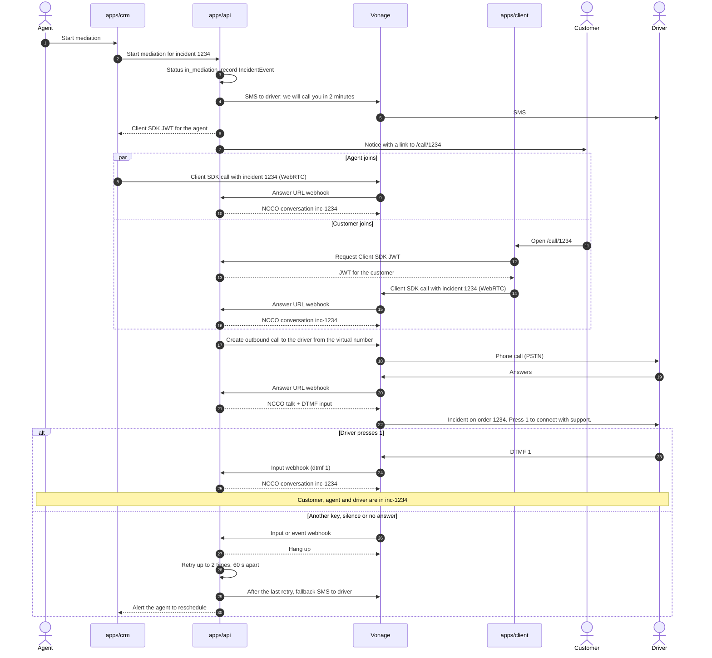

# Vonage integration

How the platform uses each Vonage API, and which webhooks Vonage sends us. Why we chose Vonage is in [ADR 0003](../adr/0003-vonage-as-communications-provider.md). What each user sees and does is in the [user flows](../design/user-flows/README.md); this page covers the technical side only.

Everything here is _planned_: the `vonage` and `webhooks` modules in `apps/api` are still empty ([#29], [#30]).

## One Vonage Application

All APIs use a single **Vonage Application** with a private key and a virtual phone number:

- Only `apps/api` holds the credentials (`VONAGE_API_KEY`, `VONAGE_API_SECRET`, `VONAGE_APPLICATION_ID`, the private key and `VONAGE_SIGNATURE_SECRET`) and calls Vonage.
- The private key also signs the short-lived JWTs that the client and the CRM use to join calls with the Client SDK.
- The application's webhook URLs point to `PUBLIC_URL` + `/webhooks/*`, which must be public HTTPS (a tunnel such as ngrok in development).

## APIs and webhooks

| Vonage API             | What we use it for                                                                                                                       | Called from                                            | Webhooks it sends us                                                                  |
| ---------------------- | ---------------------------------------------------------------------------------------------------------------------------------------- | ------------------------------------------------------ | ------------------------------------------------------------------------------------- |
| **Verify v2**          | Customer login: workflow `silent_auth`, then `sms` as fallback                                                                           | `apps/api` auth module ([#31]), through `VonageService` | Verification status                                                                   |
| **SMS** (or Messages)  | Messages to the driver (incident details, "we'll call you in 2 minutes", fallback when they don't answer) and confirmations to the customer and driver when the incident is resolved | `apps/api` incidents module, through `VonageService`   | Delivery receipts (`/webhooks/sms/status`), inbound SMS from the driver (`/webhooks/sms/inbound`) |
| **Voice API**          | Conversation `inc-<id>`, outbound PSTN call to the driver with an NCCO menu (`talk` + DTMF `input`), inbound calls to the virtual number | `apps/api` incidents module, through `VonageService`   | Answer URL (`/webhooks/voice/answer`), event URL (`/webhooks/voice/event`), DTMF input (`/webhooks/voice/input`) |
| **Client SDK** (WebRTC) | Customer and agent audio from the browser, in the same conversation as the driver                                                       | `apps/client` (`/call/:id`, [#36]) and `apps/crm` (`/incidents/:id/mediation`, [#39]), with a JWT from `apps/api` | No webhooks of its own: calls from the browser go through the Voice API answer and event URLs |
| **Video API** (phase 2) | Customer–agent video. The driver still joins by audio only, through SIP to the Voice API                                               | `apps/client`, `apps/crm`                              | Session events                                                                        |

Webhook paths come from [#30] and can still change, but stay under `/webhooks/*`. Every webhook checks Vonage's signature and is idempotent (see [cross-cutting concerns](README.md#cross-cutting-concerns)).

### Driver SMS replies

The driver can reply to an incident SMS with a short option, for example `1` delivered, `2` can't find the address, `3` customer not home. The inbound SMS webhook finds the incident by the sender's number, records the reply as a `Communication` and, when relevant, changes the incident status. An unknown reply gets a short "please answer 1, 2 or 3" and changes nothing.

If an SMS delivery receipt says the message wasn't delivered, the CRM alerts the agent.

## Mediation call

The agent starts the mediation from the CRM. The customer and the agent join the conversation `inc-<id>` over WebRTC; the API calls the driver over PSTN, and the driver only joins after pressing 1, so a voicemail never joins the call.

The diagram uses incident `1234`, so the conversation is `inc-1234`.



### NCCOs

When the driver answers, the Voice API asks the answer URL for an NCCO. First it announces the incident and waits for one key:

```json
[
  {
    "action": "talk",
    "language": "es-ES",
    "text": "Incidencia en el pedido 1234. Pulse 1 para conectar con soporte."
  },
  {
    "action": "input",
    "type": ["dtmf"],
    "dtmf": { "maxDigits": 1, "timeOut": 8 },
    "eventUrl": ["<PUBLIC_URL>/webhooks/voice/input?incident=1234"]
  }
]
```

If the digit is `1`, the input webhook answers with the NCCO that joins the conversation. The customer's and the agent's calls get the same NCCO from the answer URL:

```json
[{ "action": "conversation", "name": "inc-1234" }]
```

Any other key, or silence, hangs up and counts as a failed attempt. The `talk` text and its `language` come from the driver's `locale` (`buildDriverPromptNcco` in `apps/api/src/vonage/ncco.ts`); see [i18n](../i18n.md) ([#26]).

### Closing the call

The agent records the resolution, ends the conversation and the incident moves to `resolved`. The API sends a confirmation SMS to the customer and the driver.

## Driver calls or texts back

If the driver calls or texts the virtual number, the API looks up their active incident by the caller's number:

- **Inbound call:** if a conversation `inc-<id>` is open, the answer URL returns the NCCO that joins it. If not, the call is recorded and the assigned agent is alerted.
- **Inbound SMS:** the message is recorded in the incident and the assigned agent is alerted.

Unknown numbers are recorded and logged, and nothing else happens.

[#26]: https://github.com/femCodersClub-vonage-program/customer-support-logistics/issues/26
[#29]: https://github.com/femCodersClub-vonage-program/customer-support-logistics/issues/29
[#30]: https://github.com/femCodersClub-vonage-program/customer-support-logistics/issues/30
[#31]: https://github.com/femCodersClub-vonage-program/customer-support-logistics/issues/31
[#36]: https://github.com/femCodersClub-vonage-program/customer-support-logistics/issues/36
[#39]: https://github.com/femCodersClub-vonage-program/customer-support-logistics/issues/39
