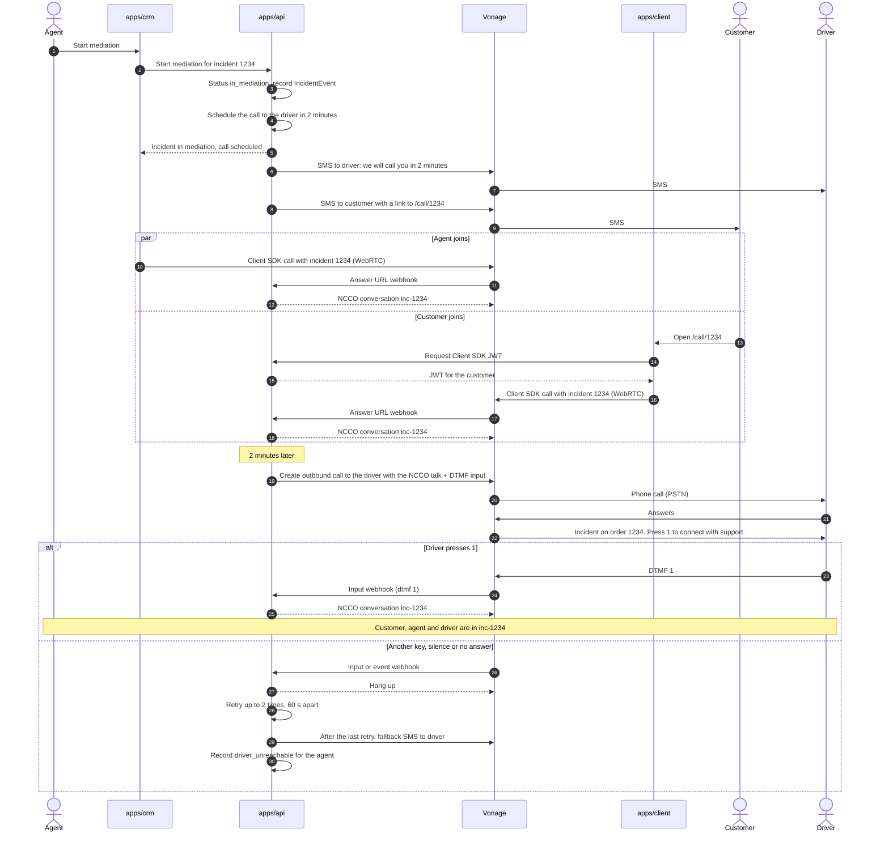

# Vonage integration

How the platform uses each Vonage API, and which webhooks Vonage sends us. Why we chose Vonage is in [ADR 0003](../adr/0003-vonage-as-communications-provider.md). What each user sees and does is in the [user flows](../design/user-flows/README.md); this page covers the technical side only.

`VonageService` in `apps/api` is in place ([#29]): configuration, the SDK client, error handling and a test SMS script are described in the [API README](../../apps/api/README.md#vonage). The webhooks are implemented in `apps/api/src/webhooks` ([#30]) and answer invalid driver replies through `VonageService`. The outbound call to the driver when the agent starts the mediation is in place too ([#39]; see [Starting the mediation](#starting-the-mediation)), and so are the Client SDK tokens and the customer's call from the PWA ([#36]; see [Joining from the browser](#joining-from-the-browser)). The other flows that use it are still _planned_.

## One Vonage Application

All APIs use a single **Vonage Application** with a private key and a virtual phone number:

- Only `apps/api` holds the credentials (`VONAGE_API_KEY`, `VONAGE_API_SECRET`, `VONAGE_APPLICATION_ID`, `VONAGE_PRIVATE_KEY` and `VONAGE_SIGNATURE_SECRET`) and calls Vonage, always through `VonageService`. The private key is passed as its content, not as a file path, which is easier in containers.
- The private key also signs the short-lived JWTs that the client and the CRM use to join calls with the Client SDK.
- The application's webhook URLs point to `PUBLIC_URL` + `/webhooks/*`, which must be public HTTPS (a tunnel such as ngrok in development).

## APIs and webhooks

| Vonage API              | What we use it for                                                                                                                                                                   | Called from                                                                                                       | Webhooks it sends us                                                                                             |
| ----------------------- | ------------------------------------------------------------------------------------------------------------------------------------------------------------------------------------ | ----------------------------------------------------------------------------------------------------------------- | ---------------------------------------------------------------------------------------------------------------- |
| **Verify v2**           | Customer login: workflow `silent_auth`, then `sms` as fallback                                                                                                                       | `apps/api` auth module ([#31]), through `VonageService`                                                           | Verification status                                                                                              |
| **Messages API** (SMS)  | Messages to the driver (incident details, "we'll call you in 2 minutes", fallback when they don't answer) and confirmations to the customer and driver when the incident is resolved | `apps/api` incidents module, through `VonageService`                                                              | Delivery receipts (`/webhooks/sms/status`), inbound SMS from the driver (`/webhooks/sms/inbound`)                |
| **Voice API**           | Conversation `inc-<id>`, outbound PSTN call to the driver with an NCCO menu (`talk` + DTMF `input`), inbound calls to the virtual number                                             | `apps/api` incidents module, through `VonageService`                                                              | Answer URL (`/webhooks/voice/answer`), event URL (`/webhooks/voice/event`), DTMF input (`/webhooks/voice/input`) |
| **Client SDK** (WebRTC) | Customer and agent audio from the browser, in the same conversation as the driver                                                                                                    | `apps/client` (`/call/:id`, [#36]) and `apps/crm` (`/incidents/:id/mediation`, [#39]), with a JWT from `apps/api` | No webhooks of its own: calls from the browser go through the Voice API answer and event URLs                    |
| **Video API** (phase 2) | Customer–agent video. The driver still joins by audio only, through SIP to the Voice API                                                                                             | `apps/client`, `apps/crm`                                                                                         | Session events                                                                                                   |

SMS go through the **Messages API**, not the older SMS API: its webhooks are signed the same way as the Voice API ones, so one guard checks both.

## Webhooks

| Route                        | Vonage setting                        | Response           | Idempotency key                               |
| ---------------------------- | ------------------------------------- | ------------------ | --------------------------------------------- |
| `POST /webhooks/sms/inbound` | Messages: Inbound URL                 | `204`              | `message_uuid`                                |
| `POST /webhooks/sms/status`  | Messages: Status URL                  | `204`              | `message_uuid` + `status`                     |
| `GET /webhooks/voice/answer` | Voice: Answer URL (also `POST`)       | `200` with an NCCO | None: it only reads                           |
| `POST /webhooks/voice/event` | Voice: Event URL                      | `204`              | `uuid` + `status` + `timestamp`               |
| `POST /webhooks/voice/input` | `eventUrl` of the NCCO `input` action | `200` with an NCCO | `uuid` (or `conversation_uuid`) + `timestamp` |

**Signature.** Vonage signs Voice and Messages webhooks with an HS256 JWT in `Authorization: Bearer`, using the account's signature secret (`VONAGE_SIGNATURE_SECRET`). `VonageSignatureGuard` checks the signature, `iss: Vonage`, `api_key` (when `VONAGE_API_KEY` is set), that `iat` is within 5 minutes and that `payload_hash` is the SHA-256 of the raw body. Anything else gets `401` and a log line with the reason; nothing is processed.

**Idempotency.** Each event is stored in `webhook_events` with a unique `(source, event_key)` before anything else, in the same transaction as its effects. A repeated event answers `2xx` and does nothing; a failed one rolls back, so Vonage's retry processes it again. The input webhook answers a repeated event with the same NCCO.

**Speed.** The work is a few queries per event. The only slow step, sending the "please reply 1 or 2" SMS, runs after the response (`BackgroundTasks`).

**Rate limit.** `WEBHOOK_RATE_LIMIT_PER_MINUTE` per client IP and route (see [cross-cutting concerns](README.md#cross-cutting-concerns)).

**Communications.** Every SMS and call is stored as a `Communication`, also from unknown numbers (without incident). Numbers are stored in E.164; Vonage sends them without `+`. Statuses map to ours: `submitted` → `in_progress`, `delivered` → `completed`, `rejected` / `undeliverable` → `failed`; for calls, `started` / `ringing` → `queued`, `answered` → `in_progress`, `completed` → `completed`, `busy`, `cancelled`, `unanswered`, `rejected`, `failed` and `timeout` → `failed`. A status never goes back, so late events don't undo newer ones.

**Finding the incident.** By the driver's phone (`drivers` → `routes` → `orders`), taking their most recent incident in `notified` or `in_mediation`; by `?incident=<id>` on the input URL; and, for browser calls, by `incidentId` in the Client SDK's `custom_data`.

### Driver SMS replies

The driver replies to the incident SMS with one of the options of the [driver flow](../design/user-flows/driver.md): `1` resolves it with the store, `2` asks for a three-way mediation. The inbound SMS webhook finds the incident by the sender's number and records the reply as a `Communication`. If the incident is `notified`:

| Reply | Reason               | Effect                                                                                                                                         |
| ----- | -------------------- | ---------------------------------------------------------------------------------------------------------------------------------------------- |
| `1`   | `resolve_with_store` | `IncidentEvent` with `kind: driver_replied` and `actor: driver`; the incident stays `notified` and the agent records the outcome (`resolved`). |
| `2`   | `request_mediation`  | `IncidentEvent` with `kind: status_changed`: `notified` → `in_mediation`, `actor: driver`. The agent starts the call from there.               |
| other | —                    | A short "please reply 1 or 2" SMS; nothing changes.                                                                                            |

Once the incident is in mediation, messages are only recorded.

If an SMS delivery receipt says the message wasn't delivered, the CRM alerts the agent.

## Mediation call

The agent starts the mediation from the CRM. The customer and the agent join the conversation `inc-<id>` over WebRTC; the API calls the driver over PSTN, and the driver only joins after pressing 1, so a voicemail never joins the call.

The diagram uses incident `1234`, so the conversation is `inc-1234`. The status change, the call to the driver ([#39]), the Client SDK JWTs and the customer's call from the PWA ([#36]) are in place, and so are the SMS before the call, the invite to the customer, and the retries and fallback SMS when the driver doesn't answer ([#85]). The agent's audio in the CRM and the agent alert are still _planned_.



### NCCOs

The API sends the driver's NCCO with the outbound call, so Vonage doesn't ask the answer URL for it. The answer URL returns the same NCCO for calls to the driver created without one, for example by hand. First it announces the incident and waits for one key:

```json
[
  {
    "action": "talk",
    "language": "es-ES",
    "text": "Incidencia en el pedido 1234. Pulse 1 para conectar con soporte."
  },
  {
    "action": "input",
    "type": ["dtmf"],
    "dtmf": { "maxDigits": 1, "timeOut": 8 },
    "eventUrl": ["<PUBLIC_URL>/webhooks/voice/input?incident=1234"]
  }
]
```

If the digit is `1`, the input webhook answers with the NCCO that joins the conversation. The customer's and the agent's calls get the same NCCO from the answer URL:

```json
[{ "action": "conversation", "name": "inc-1234" }]
```

Pressing `1` also moves a `notified` incident to `in_mediation` with `actor: driver` and reason `accepted_call`; answering the call doesn't, since a voicemail can answer too. Any other key, or silence, gets a short message and the call ends; it counts as a failed attempt. The `talk` text and its `language` come from the driver's `locale` (`buildDriverPromptNcco` in `apps/api/src/vonage/ncco.ts`); see [i18n](../i18n.md) ([#26]).

### Starting the mediation

Two agent-only endpoints in `apps/api` (`MediationService` in `apps/api/src/incidents/mediation.service.ts`) create the call to the driver:

| Route                                       | What it does                                                                                                                                                                                    | Response                              |
| ------------------------------------------- | ----------------------------------------------------------------------------------------------------------------------------------------------------------------------------------------------- | ------------------------------------- |
| `POST /incidents/:id/mediation`             | Moves a `notified` incident to `in_mediation` with `actor: agent` (nothing changes if it is already in mediation), assigns it to the agent if it has none, and schedules the call to the driver | `201` with `{ incident, call: null }` |
| `POST /incidents/:id/mediation/driver-call` | Calls the driver again while the incident is `in_mediation`                                                                                                                                     | `201` with the call (`Communication`) |

Each call is stored as an outbound voice `Communication`, with the Vonage call id as `vonageUuid`, and the event webhook updates it from there. The incident row is locked while the mediation is started, so two agents starting it at once schedule it once: the second one gets `201` and nothing new happens.

- **`403`:** the actor is not an agent.
- **`404`:** the incident doesn't exist.
- **`409`:** the incident can't move to `in_mediation` (`INVALID_TRANSITION`), `driver-call` was sent for an incident that isn't in mediation, the incident has no driver, or (`driver-call` only) a call to the driver is still active. A call counts as active while it is `in_progress`, or while it is `pending` or `queued` and less than 2 minutes old, so a call whose events never arrive doesn't block the agent.
- **`502`** (`BAD_GATEWAY`, `driver-call` only): Vonage didn't create the call. Nothing is stored for it, and the agent can try again.

Starting the mediation requires the incident to be `notified`, so it follows the "Notify driver" action ([#38]).

### SMS before the call, invite and retries

Starting the mediation doesn't call Vonage during the request. In the same transaction as the status change it reserves two SMS and schedules the first call, as background jobs on pg-boss ([ADR 0013](../adr/0013-background-jobs-with-pg-boss.md), `apps/api/src/jobs`). Each SMS and call is reserved first as a `Communication` in `pending` with a unique `idempotencyKey`, so a job that runs twice, a repeated webhook or a restart never sends or calls twice for the same step:

| Step          | `idempotencyKey`               | When                                                     | To       | Template          |
| ------------- | ------------------------------ | -------------------------------------------------------- | -------- | ----------------- |
| Call soon     | `mediation:<id>:call-soon`     | Right away                                               | Driver   | `callSoon`        |
| Invite        | `mediation:<id>:invite`        | Right away                                               | Customer | `mediationInvite` |
| Call 1        | `mediation:<id>:call:1`        | `MEDIATION_CALL_DELAY_SECONDS` (120) later               | Driver   | Driver prompt     |
| Calls 2 and 3 | `mediation:<id>:call:<n>`      | `MEDIATION_RETRY_DELAY_SECONDS` (60) after a failed call | Driver   | Driver prompt     |
| Fallback      | `mediation:<id>:call-fallback` | After the third failed call                              | Driver   | `callFallback`    |

- **Locale.** Each SMS is in its recipient's `locale`. The invite links to `<CLIENT_PUBLIC_URL>/call/<id>`. `GET /incidents/:id` returns it as `mediationInvite` (`{ url, sentAt }`, or `null` before the mediation starts), so the PWA can show the "Join the call" card ([#34]).
- **Failed call.** A call fails when its event is `busy`, `unanswered`, `rejected`, `failed`, `timeout` or `cancelled`, when the driver presses another key or nothing, or when Vonage doesn't create it. The event or input webhook schedules the next call in the same transaction that records the event.
- **Skipped calls.** Before calling, the job locks the incident and does nothing if it is no longer `in_mediation`, if the driver has joined (pressed 1 on any call, or called in while the mediation was open: `IncidentEvent` `driver_joined`), or if a call the agent placed by hand is still active. If the driver has already joined when the mediation starts, only the customer gets an SMS.
- **Fallback.** After the third failed call the driver gets `callFallback`, and the timeline gets an `IncidentEvent` `driver_unreachable` (`actor: system`, reason `no_answer_after_retries`) for the agent. The incident stays `in_mediation`, so the agent decides whether to call again or escalate.
- **Vonage errors.** An SMS that Vonage rejects is stored as `failed` and not sent again. It doesn't undo the status change, and the call is still placed.
- **Early events.** Vonage may send the first event of a call before the job has stored the call id. The event webhook then adopts the driver's `pending` call reservation instead of creating a second `Communication`.
- **Call driver again** (`driver-call`) still calls right away, and its calls are not retried automatically.

### Joining from the browser

The customer (PWA, `/call/:id`) and the agent (CRM) join `inc-<id>` with the Vonage Client SDK for JavaScript (`@vonage/client-sdk`), using a short-lived JWT from the API ([#36]):

| Route                       | Who                  | What it does                                                                                                                                          | Response                                    |
| --------------------------- | -------------------- | ----------------------------------------------------------------------------------------------------------------------------------------------------- | ------------------------------------------- |
| `POST /vonage/client-token` | Customers and agents | With `{ incidentId }`: creates the Vonage user if it doesn't exist yet, and signs a JWT for it with the application private key, valid for 15 minutes | `201` with `{ token, userName, expiresAt }` |

- **Users.** Each customer and agent has one Vonage user, named `cust-<id>` or `agent-<id>` (`apps/api/src/vonage/vonage-users.ts`). The API creates it on the first token and treats Vonage's `409` (the name already exists) as success, so nothing is stored in our database.
- **JWT.** `sub` is the user name. The ACLs are only those needed to start, control and hang up a call, plus conversation events, which `mute` needs (`CLIENT_TOKEN_ACL` in `apps/api/src/vonage/client-token.ts`).
- **Who gets one.** A customer only gets a token for an incident on one of their orders (`404` otherwise), an agent for any incident, and the incident must be `in_mediation` (`409` otherwise). `502` means Vonage didn't create the user.
- **The call.** The browser starts the call with `serverCall({ incidentId })`. Vonage asks the answer URL with `endpoint_type: app`, the caller's user name in `from_user` and the context in `custom_data`. The answer URL joins the call to `inc-<id>` only if the incident is `in_mediation` and `from_user` is the customer who owns it or an existing agent. Any other call gets `[]` and hangs up, so a valid token for one incident can't join another incident's conversation.
- **Recording.** Before joining it, the answer URL stores the call as an inbound voice `Communication` of the incident, with the leg's `uuid` as `vonageUuid`. If an event webhook stored it first without an incident, it links it. This way the API knows every leg of `inc-<id>` when it closes the call.

In the PWA (`apps/client/src/call`):

- The SDK is only loaded on `/call/:id`, with a dynamic `import()`. It is a separate chunk of about 314 kB gzipped, outside the main bundle. The service worker still precaches it, like every other chunk.
- Before the call, the page explains who is on it and why the browser will ask for the microphone. The microphone is only requested when the customer taps **Join the call**. If the browser blocks it, the page shows how to allow it in Chrome on Android and Safari on iPhone.
- The call status (connecting, joining, connected, reconnecting, ended) is in a `role="status"` region, so screen readers announce each change. The duration is outside it, so it isn't read every second.
- The session is refreshed with a new token (`refreshSession`) one minute before the token expires.
- The screen stays awake during the call with the Wake Lock API, where the browser has it.
- When the customer hangs up, the page goes back to `/incidents/:id`. When the other side ends the call, it says so and links back to the incident.
- Audio only for now: no speaker toggle, because Safari on iOS doesn't support `setSinkId` and Chrome on Android only reports the default output.

### Mediation screen

The CRM page `/incidents/:id/mediation` (`apps/crm/src/app/incidents/[id]/mediation`) shows the incident summary (type, status, order, customer, driver and the driver's last reply) next to the call with the driver. Its Server Actions call the endpoints above through `@csl/api-client`:

- **Start mediation** when the incident is `notified`, and **Call driver again** while it is `in_mediation`. The button is disabled while the driver's last call is `in_progress`.
- The status of the driver's last outbound voice `Communication` is shown as it was when the page loaded. It updates after each action, and without reloading once the live updates of [#40] are in place.
- A `409` or `502` is shown to the agent as a short message, and they can retry.

The Client SDK JWT is available ([#36], see [Joining from the browser](#joining-from-the-browser)). The agent's audio, the participants panel and the call controls in the CRM are still _planned_.

### Closing the call

The mediation form records the outcome with `PATCH /incidents/:id/status`, which adds an `IncidentEvent` to the timeline:

| Outcome          | Status      | Reason                              |
| ---------------- | ----------- | ----------------------------------- |
| Resolved         | `resolved`  | The note, if any                    |
| Escalated        | `escalated` | The note, if any                    |
| Follow-up needed | `escalated` | `follow_up_needed`, plus `: <note>` |

When the status moves to `resolved` or `escalated` (from the mediation form or from the incident detail, [#38]), the same transaction:

- stores one outbound SMS `Communication` in `pending` for each recipient, so it appears in the timeline right away:

  | Status      | Customer                                | Driver                          |
  | ----------- | --------------------------------------- | ------------------------------- |
  | `resolved`  | `resolvedCustomer`                      | `resolvedDriver`, if it has one |
  | `escalated` | `escalatedCustomer` ("we keep working") | -                               |

- reads the voice `Communication`s of the incident that are still `queued` or `in_progress`.

After the commit, `BackgroundTasks` (`apps/api/src/common/background`):

- hangs up each of those calls with `hangupCall` (`PUT /v1/calls/:uuid`, `action: hangup`). Vonage's `404` or `410` means the call had already ended. When every leg hangs up, the conversation `inc-<id>` ends for everyone;
- sends each SMS in the recipient's `locale`. When Vonage accepts it, the `Communication` gets the message id and moves to `queued`, and the status webhook updates it from there. When Vonage rejects it (`4xx`, or Vonage disabled), it moves to `failed`. A timeout or a `5xx` leaves it in `pending`, because the SMS may have been sent.

A Vonage failure never undoes the status change: it is logged and visible in the timeline. The agent's note is not sent. Patching the same status again returns `409` (`INVALID_TRANSITION`), so nothing is sent twice. Moving an escalated incident to `resolved` later sends the resolution SMS.

## Driver calls or texts back

If the driver calls or texts the virtual number, the API looks up their active incident by the caller's number:

- **Inbound call:** if a conversation `inc-<id>` is open, the answer URL returns the NCCO that joins it. If not, the call is recorded and the assigned agent is alerted.
- **Inbound SMS:** the message is recorded in the incident and the assigned agent is alerted.

Unknown numbers are recorded and logged, and nothing else happens.

## Local development

### Tunnel

Vonage needs public HTTPS URLs. Start the API, then a tunnel to its port, and put the tunnel's URL in `PUBLIC_URL` (the API uses it to build the input URL of the driver's call):

```sh
ngrok http 3000
# or
cloudflared tunnel --url http://localhost:3000
```

Free ngrok and quick cloudflared tunnels change their URL on each run, so update `PUBLIC_URL` and the Vonage application each time.

### Vonage application

In the [Vonage dashboard](https://dashboard.nexmo.com):

1. **API settings:** copy the signature secret to `VONAGE_SIGNATURE_SECRET` and the API key to `VONAGE_API_KEY`, and set the default SMS setting to the **Messages API**.
2. **Applications → your application → Voice:** Answer URL `GET <PUBLIC_URL>/webhooks/voice/answer`, Event URL `POST <PUBLIC_URL>/webhooks/voice/event`, and turn on signed webhooks (older applications have them off).
3. **Applications → your application → Messages:** Inbound URL `<PUBLIC_URL>/webhooks/sms/inbound` and Status URL `<PUBLIC_URL>/webhooks/sms/status`.
4. Link the virtual number to the application.

### Without a phone

`apps/api/scripts/replay-vonage-webhook.mjs` signs a sample payload from `apps/api/test/fixtures/vonage/` with your secret and sends it to the local API; see the [API README](../../apps/api/README.md#vonage-webhooks). The e2e tests (`apps/api/test/webhooks.e2e-spec.ts`) use the same payloads.

### Manual end-to-end check

With the tunnel and the application set up, a driver in the database whose phone you have, and an order on their route with an incident in `notified`:

1. **SMS reply:** text `2` from the driver's phone to the virtual number. Expect `204` in the API logs, the incident in `in_mediation` and an `IncidentEvent` with `actor: driver` and reason `request_mediation`. Text `1` for another `notified` incident: it stays `notified`, with a `driver_replied` event and reason `resolve_with_store`.
2. **Invalid reply:** set another incident to `notified` and text `hola`. Expect the "please reply 1 or 2" SMS on the driver's phone.
3. **Call and DTMF:** set another incident to `notified` and send `POST /incidents/<id>/mediation` as an agent, with the session cookie (see [logging in locally as an agent](../../apps/api/README.md#logging-in-locally-as-an-agent)), or start it from the CRM. Expect `201`, the incident in `in_mediation` and assigned to the agent, and a call to the driver's phone with the prompt in their language. Pressing `1` joins `inc-<id>`; another key plays the short message and hangs up. Then `POST /incidents/<id>/mediation/driver-call` calls again once the first call has ended.
4. **Call back:** call the virtual number from the driver's phone while their incident is in mediation; the call joins `inc-<id>`.
5. **Signature:** send a request with `curl` to any `/webhooks/*` route; expect `401`.

Check as well, since the docs don't say it: that the `GET` answer webhook carries the JWT, that `payload_hash` is hex, and that an empty NCCO (`[]`) hangs up.

### Three-way call from the browser

This is the manual check for [#36]. You need:

- The tunnel and the Vonage application set up as above, with the API and the client running. The microphone needs HTTPS too, so open the client on the phones through its own tunnel (see [testing the PWA on a phone](../pwa.md#testing-on-a-phone)).
- A customer in the database whose phone you can log in with, an order of theirs on a driver's route with an incident, and the driver's phone.
- An Android phone with Chrome and an iPhone with Safari. You can repeat the call with each one.

Steps:

1. **Start the mediation** as an agent (see step 3 of the manual end-to-end check) and press `1` on the driver's phone. The incident is now `in_mediation`.
2. **Customer joins.** Log in on the phone and open `/call/<incident id>`. The page lists who is on the call and explains the microphone, and the browser doesn't ask for it yet. Tap **Join the call** and allow the microphone. The status goes from "Connecting…" to "Joining the call…" and "Connected", and the duration starts. The customer and the driver hear each other.
3. **Agent joins.** From the CRM, once its call is in place ([#39]), join the same incident. The three of them hear each other. Until then, the customer and the driver are enough to check the call.
4. **Controls.** **Mute microphone** silences the customer for the others and shows as pressed. Turn the screen off for a minute and back on: the call is still up. While connected, the screen doesn't dim on its own.
5. **Connection.** Turn Wi-Fi off on the phone while on mobile data, or turn airplane mode on for a few seconds. The status says "Reconnecting…" and then "Connected" again, or the page offers **Try again** if the call drops.
6. **Token refresh.** Stay on the call for more than 15 minutes. It doesn't drop. With remote debugging (Chrome DevTools or Safari Web Inspector), the network panel shows a second `POST /api/vonage/client-token` about a minute before the first token expires.
7. **Ended by the other side.** End the call from the CRM, or hang up every other leg. The page says "Support ended the call." and links back to the incident.
8. **Hang up.** Join again and tap **Hang up**. The page goes back to `/incidents/<id>`, and the browser's back button doesn't return to the call.
9. **Microphone denied.** Block the microphone for the site and tap **Join the call**, or open the page with it already blocked. The help screen shows the steps for Chrome and Safari, never an empty page. Follow them and tap **Try again**.
10. **Another incident.** As the same customer, open `/call/<id>` of an incident that isn't theirs. The token request answers `404` and the page says the call isn't available. A call to that incident with a valid token from another user hangs up straight away, because of the answer URL check: the e2e tests in `apps/api/test/webhooks.e2e-spec.ts` cover it, and the API logs a warning when it happens.
11. **Screen reader.** With TalkBack (Android) or VoiceOver (iPhone), go through steps 2, 4 and 8. Each status change is read out, the buttons have their names, and mute is announced as a toggle.
12. **Bundle.** Run `pnpm --filter ./apps/client run build`. The SDK is in its own chunk (`assets/client-*.js`), and the main chunk that `index.html` loads doesn't contain it.

Confirm as well, since the SDK and Vonage docs don't say it clearly: that Vonage sends `legStatusUpdate` with `ANSWERED` when the browser joins the conversation (the page relies on it to show "Connected"), that `custom_data` arrives in the `GET` answer webhook as a JSON string, and that creating a user that already exists answers `409`.

[#26]: https://github.com/femCodersClub-vonage-program/customer-support-logistics/issues/26
[#29]: https://github.com/femCodersClub-vonage-program/customer-support-logistics/issues/29
[#30]: https://github.com/femCodersClub-vonage-program/customer-support-logistics/issues/30
[#31]: https://github.com/femCodersClub-vonage-program/customer-support-logistics/issues/31
[#34]: https://github.com/femCodersClub-vonage-program/customer-support-logistics/issues/34
[#36]: https://github.com/femCodersClub-vonage-program/customer-support-logistics/issues/36
[#38]: https://github.com/femCodersClub-vonage-program/customer-support-logistics/issues/38
[#39]: https://github.com/femCodersClub-vonage-program/customer-support-logistics/issues/39
[#40]: https://github.com/femCodersClub-vonage-program/customer-support-logistics/issues/40
[#85]: https://github.com/femCodersClub-vonage-program/customer-support-logistics/issues/85
